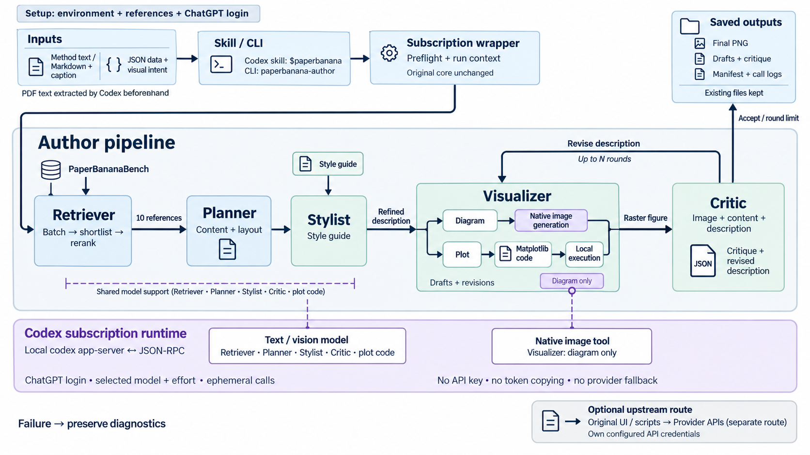

# PaperBanana-Codex 🍌

**在 Codex 中使用 ChatGPT 订阅，运行 PaperBanana 作者版的论文配图流程。**

本项目基于论文第一作者维护的 [dwzhu-pku/PaperBanana](https://github.com/dwzhu-pku/PaperBanana)，
新增本地 Codex 订阅适配器和 `$paperbanana` 技能。作者的 agents、prompts、
风格指南及核心 provider 文件保持原样；适配器在运行时连接 Codex app-server。

Codex subscription integration for the first author's PaperBanana implementation.
See the [English integration guide](integrations/codex/README.md) for setup and technical details.

[在 Codex 中使用](#在-codex-中使用) · [命令行](#命令行使用) ·
[适配范围](#适配范围与限制) · [原作者 README](README.upstream.md) ·
[论文](https://arxiv.org/abs/2601.23265)

## 工作方式

[](assets/paperbanana-codex-workflow.png)

上图通过本仓库的 `$paperbanana` 订阅流程生成，点击可查看原图。
它展示默认工作流、方法图与统计图两种渲染路径，以及独立保留的原版 API 入口。
[绘图说明](docs/figures/workflow-method.md) · [生成记录](docs/figures/workflow-generation.json)

- **文字和视觉理解**：默认继承你在 Codex 中配置的模型和推理档位。
- **方法图出图**：使用 Codex 原生图片生成工具。
- **认证**：使用本机已有的 ChatGPT 登录；此订阅入口无需另配模型 API Key。
- **参考图**：使用作者的 PaperBananaBench 数据集。

模型权限、图片生成可用性和使用额度取决于登录账号。适配器不会自动切换到收费 API。

## 快速安装（macOS / Linux）

准备 Git、[uv](https://docs.astral.sh/uv/getting-started/installation/)、Python 3.12，
以及支持 app-server 和原生图片生成的 Codex CLI。本适配器已在 Codex CLI 0.163.0 上验证。

```bash
git clone https://github.com/YuChenSSR/PaperBanana-codex.git
cd PaperBanana-codex

uv python install 3.12
uv venv --python 3.12
uv pip install --python .venv/bin/python -r requirements.txt

# 下载参考图库
.venv/bin/python scripts/prepare_bench.py --tasks diagram plot

# 安装调用命令和 Codex 技能
.venv/bin/python integrations/codex/install.py
```

确认 `codex login status` 显示通过 ChatGPT 登录。若尚未登录，运行 `codex login`
完成登录，然后检查安装：

```bash
~/.local/bin/paperbanana-author doctor
```

| 入口 | 名称 / 位置 |
| --- | --- |
| Codex 技能 | `$paperbanana` |
| 技能目录 | `$CODEX_HOME/skills/paperbanana`，默认 `~/.codex/skills/paperbanana` |
| 命令行工具 | `~/.local/bin/paperbanana-author` |
| 适配器源码 | `integrations/codex/` |

安装器会将旧的 `paperbanana-author` 技能迁移为 `paperbanana`，并备份它自己的旧文件。
安装后请保留仓库及 `.venv`，因为调用命令指向这个环境。

## 在 Codex 中使用

新开一个 Codex 对话，提供方法说明或论文文件，然后输入：

> 用 $paperbanana 根据这份方法说明生成论文架构图，使用订阅模式。

也可以明确要求模块、语言、布局和修改轮数：

> 用 $paperbanana 画这个方法的流程图，英文标签、横向布局，保留所有模块与箭头关系，生成一个候选并检查修改一轮。

技能会准备输入、调用作者流程、检查最终图片，并给出输出路径。
PDF 需要先由 Codex 提取相关方法文本；适配器本身接收 UTF-8 文本或 Markdown。

## 命令行使用

将方法说明保存为 `method.md`，在自己的论文项目目录运行：

```bash
~/.local/bin/paperbanana-author generate \
  --input method.md \
  --caption "Overview of the proposed method" \
  --output figures/method.png \
  --rounds 1
```

如果 `~/.local/bin` 已在 PATH 中，可以直接使用 `paperbanana-author`。

| 参数 | 默认值 | 说明 |
| --- | --- | --- |
| `--mode` | `demo_full` | 完整流程，包含风格调整 |
| `--retrieval` | `auto` | 自动检索参考图 |
| `--candidates` | `1` | 候选数量，依次生成 |
| `--rounds` | `1` | Critic 修改轮数；`0` 跳过审查 |
| `--aspect-ratio` | `16:9` | 请求的宽高比 |
| `--image-size` | `2k` | 请求的分辨率级别 |
| `--model` / `--effort` | 继承 Codex 配置 | 显式选择模型或推理档位 |

完整流程可能需要数分钟，参考检索和多轮出图会消耗订阅额度。
更多参数可用 `paperbanana-author generate --help` 查看。

输出包括最终 PNG，以及同目录下的 `<名称>_paperbanana_<时间>/` 运行目录，
其中保留参考图选择、规划描述、Critic 意见、模型调用记录和原生图片。
已有输出不会被覆盖；继续修改时使用新文件名。

统计图入口为 `--task plot`，输入应为 JSON 数据。它使用作者的 Matplotlib
代码生成流程，目前尚未完成与方法图相同的端到端实测。

## 适配范围与限制

- **作者流程与模型接入**：保留作者核心代码，在独立包装器中替换模型调用入口。
- **长参考库输入**：Codex 单次输入限制为 1 MiB。适配器分批评估作者原定参考范围，
  再对入选参考统一筛选；这可能与原始单次检索产生不同结果。
- **模型与画质**：文字模型和图片生成后端已发生变化，因此本项目的输出不代表原论文复现指标。
- **输出尺寸**：宽高比和分辨率作为绘图要求传入，原生工具不保证精确像素尺寸。
- **原版网页入口**：直接运行 `app.py`、`demo.py`、`main.py` 或 `skill/run.py`
  仍走原版 API 配置。订阅模式请使用 `$paperbanana` 或 `paperbanana-author`。
- **协议兼容性**：app-server 及部分调用配置会随 Codex 版本变化，更新后建议先运行小样例。

详细实现、诊断及原生图片验证方式见 [适配说明](integrations/codex/README.md)。

## 已完成的验证

2026-10-19，在 Codex CLI 0.163.0、ChatGPT 登录及 `gpt-6-astra / xhigh` 下：

- 8 项适配器测试通过，包括实际 Codex 后端启动检查。
- 完整方法图样例从作者的 200 条参考候选中选出 10 条。
- 完成 8 次文字/视觉调用、3 次原生图片生成，包含一轮 Critic 驱动修改。
- 检查了最终图片的三阶段结构、标签和箭头方向。

这是功能连通性验证，尚未进行系统性的图像质量对比。

```bash
.venv/bin/python -m unittest discover -s integrations/codex -p 'test_*.py' -v
~/.local/bin/paperbanana-author doctor
```

## 原作者、论文与许可

PaperBanana 论文和原始实现来自 Dawei Zhu、Rui Meng、Yale Song、Xiyu Wei、
Sujian Li、Tomas Pfister 和 Jinsung Yoon。作者版承接了 Google Research 的
[PaperVizAgent](https://github.com/google-research/papervizagent)。
本 fork 独立维护 Codex 接入，不代表原作者、Google 或 OpenAI 的官方支持。

原作者完整的功能说明、演示、贡献者名单、引用格式及声明保留在
[README.upstream.md](README.upstream.md)。项目许可见 [LICENSE](LICENSE)。
